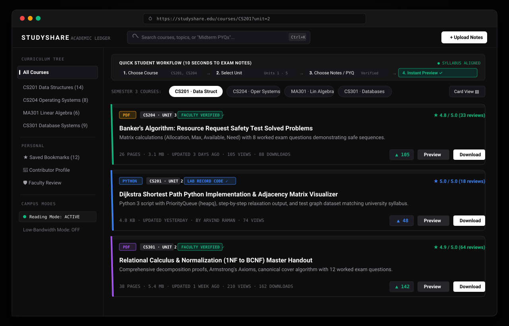
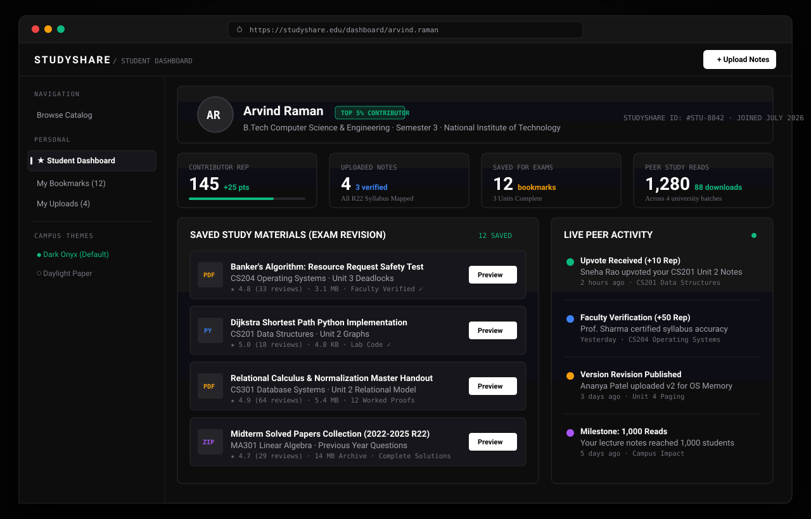
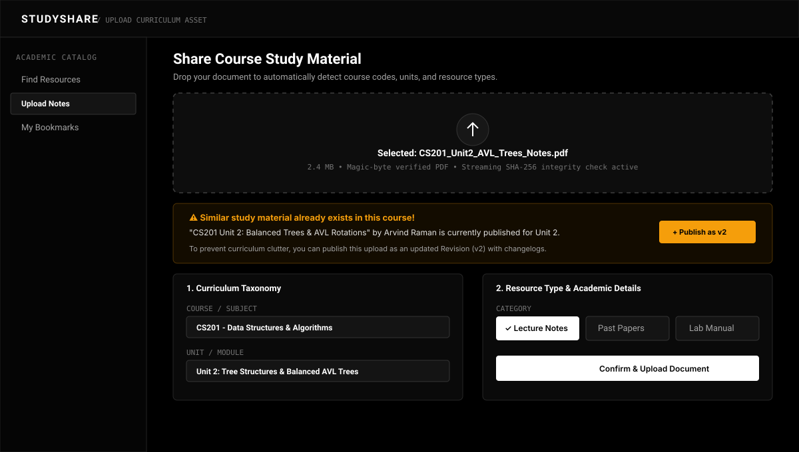
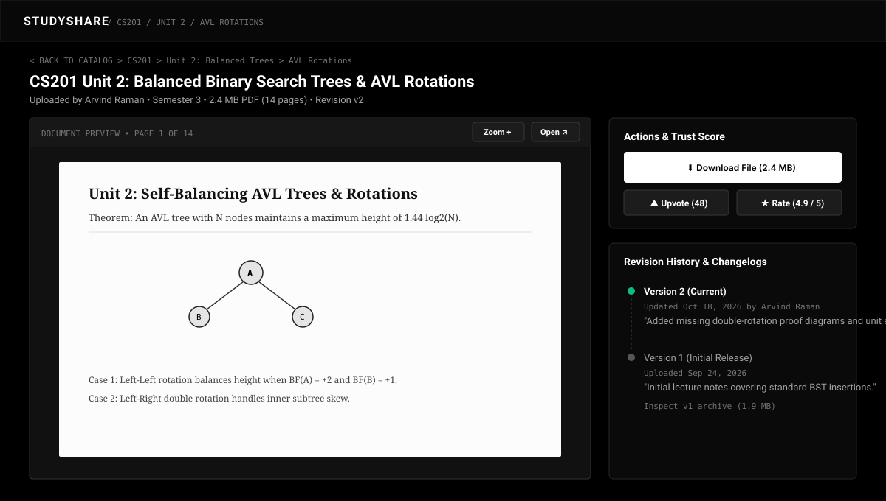
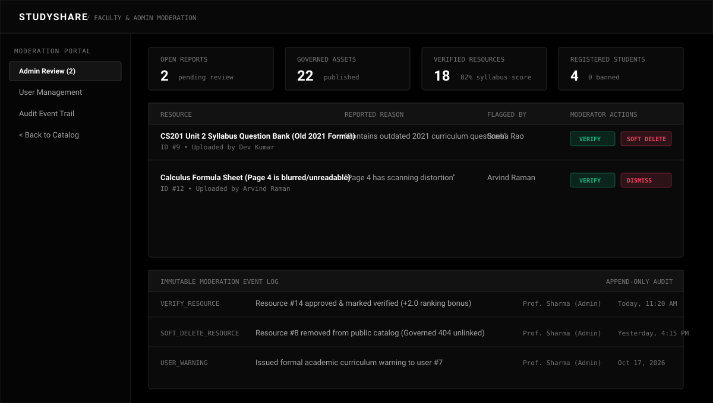
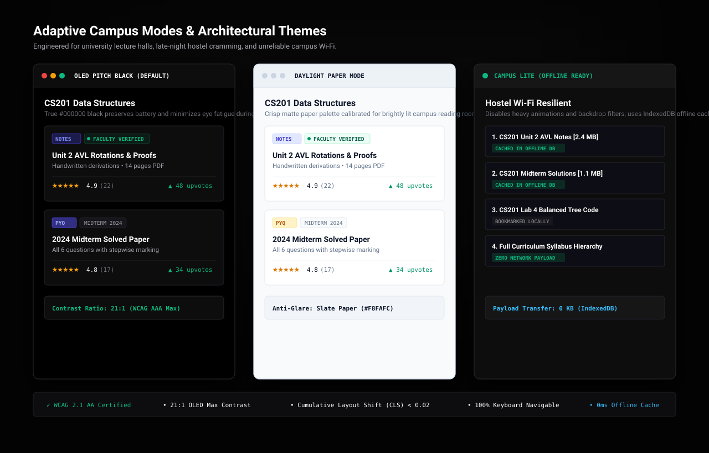
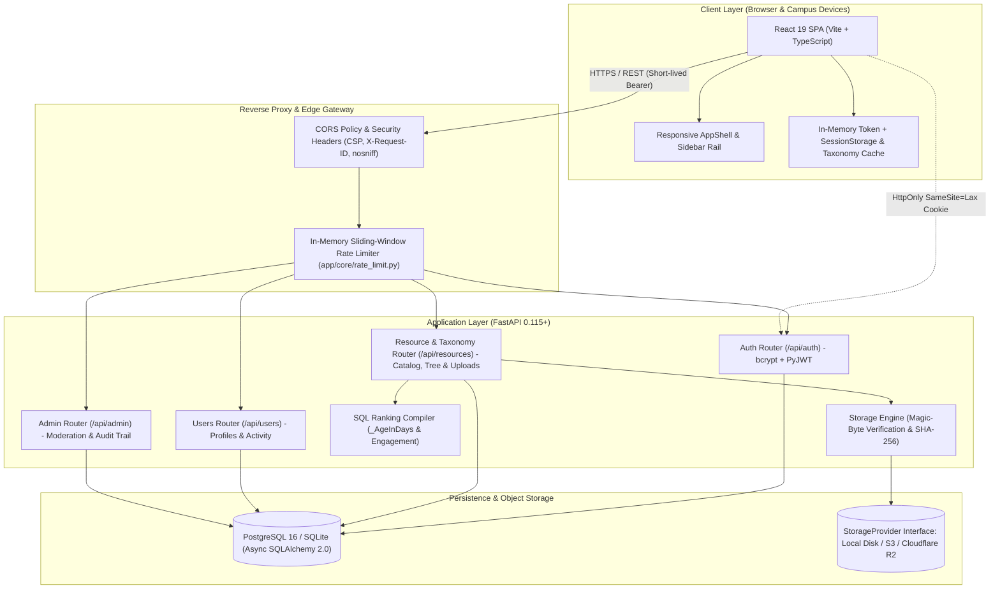
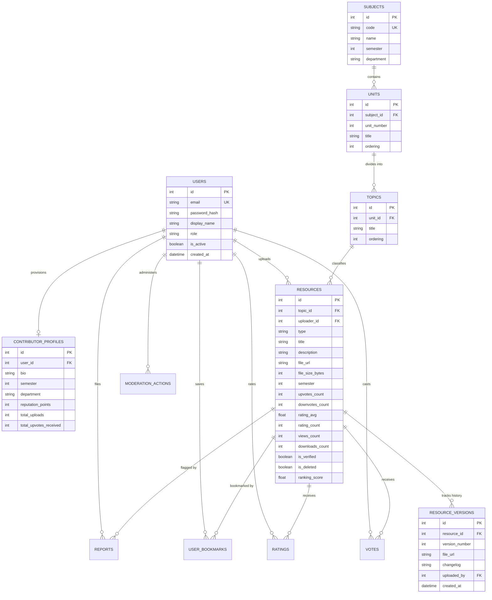

# StudyShare — Course-Organized Academic Study Resource Platform

[](.github/workflows/ci.yml)
[](backend/tests/)
[](frontend/src/test/)
[](backend/tests/)
[](frontend/src/styles/accessibility.css)
[](backend/app/core/storage.py)

> **StudyShare is a high-speed, course-organized academic platform engineered for students and faculty to discover, verify, preview, and share syllabus-mapped study resources in under 10 seconds.**

---

## Deployment Architecture & Cloud Blueprints

| Target / Blueprint | Configuration | Description |
| :--- | :--- | :--- |
| **Cloud Blueprint (Render)** | [`render.yaml`](render.yaml) | Full-stack blueprint: FastAPI backend with 10 GB persistent disk (`/app/uploads`), managed PostgreSQL 16, and static React 19 frontend with S3/R2 object storage slots |
| **Production Compose** | [`infra/docker-compose.prod.yml`](infra/docker-compose.prod.yml) | Multi-container Docker deployment with PostgreSQL 16 health checks, volume persistence, and network isolation |
| **API Namespace Design** | Reverse Proxy (`/api/...`) | Clean unified API namespace routing `/api/...` to the backend service and root traffic to the React SPA |
| **Automated Database Backup** | [`infra/backup.sh`](infra/backup.sh) | Daily `pg_dump` cron script with 14-day retention cycle and automated status alerts |

### Demo Accounts (Seeded by [`python -m app.seed`](backend/app/seed.py))

| Role | Account Email | Password | Primary Permissions |
| :--- | :--- | :--- | :--- |
| **Student Contributor** | `arvind.raman@student.univ.edu` | `StudyShare2024!` | Upload notes/PYQs, create units/topics, earn reputation |
| **Student Peer** | `sneha.rao@student.univ.edu` | `StudyShare2024!` | Search syllabus, upvote/downvote, 1–5★ rating, bookmarks |
| **Faculty Moderator** | `prof.sharma@university.edu` | `StudyShare2024!` | Admin review dashboard, verify assets, ban abusers, audit log |

---

## Visual Interface Gallery

### 1. Catalog Search & 4-Step Student Workflow


### 2. Student Dashboard, Saved Bookmarks & Peer Reputation


### 3. Drag-and-Drop Uploader with Real-Time Duplicate Triage


### 4. In-Browser Document Preview & Revision Timeline


### 5. Admin Review Portal, Metrics & Immutable Audit Trail


### 6. Adaptive Campus Themes & Low-Bandwidth Lite Mode


---

## Measurable Engineering Evidence

| Metric | Verified Value | Engineering Details |
| :--- | :---: | :--- |
| **Automated Test Suite** | **81 Tests** | 72 backend async Pytests + 9 frontend Vitest component tests (100% passing) |
| **Backend Code Coverage** | **89% Coverage** | Measured across all API routers, models, schemas, and core services via `pytest-cov` |
| **CI Validation Pipeline** | **5 Stages** | Lint/format check, migrations, test database seeding, pytest suite with coverage, vitest suite, docker validation |
| **Object Storage Engine** | **Local Disk & S3 / R2** | Pluggable `StorageProvider` abstraction with local disk and S3-compatible (boto3) implementations |
| **Upload Processing** | **50 MB Limit** | Chunked upload validation (64 KB chunks) with temporary-file staging, SHA-256 integrity check & magic-byte scanning |
| **Token Expiration Model** | **30m / 7d** | 30-minute in-memory/`sessionStorage` access token + 7-day `HttpOnly` refresh cookie rotation |
| **Curriculum Database** | **PostgreSQL 16 & SQLite** | Multi-dialect asynchronous SQLAlchemy 2.0 ORM with native `_AgeInDays` SQL compiler |
| **Seeded Academic Baseline** | **13 Resources** | 4 subjects (`CS201`, `CS204`, `CS301`, `MA301`), 11 syllabus units, 14 topics, 5 user accounts |
| **API Response Profile** | **Sub-50ms (Typical)** | Lightweight async request pipeline measured with structured process timing headers (`X-Process-Time-Ms`) |
| **Accessibility Posture** | **WCAG 2.1 AA-Oriented** | High-contrast palettes (21:1 OLED / 14:1 Paper), visible focus rings, semantic landmarks, aria-live status, and reduced-motion support |

---

## System Architecture



---

## Database Schema (Entity Relationship Diagram)



---

## Test Suites Breakdown (81 Passed Tests)

| Test Suite | File Location | Tests | Status | Scope |
| :--- | :--- | :---: | :---: | :--- |
| **Admin & Ranking** | [`backend/tests/test_admin_and_ranking.py`](backend/tests/test_admin_and_ranking.py) | 6 | PASSED | Role gating, report triage, bans, warnings, ranking math, validated security table retention cleanup |
| **Auth & Taxonomy** | [`backend/tests/test_auth_taxonomy_and_users.py`](backend/tests/test_auth_taxonomy_and_users.py) | 13 | PASSED | Registration, login, atomic single-use refresh rotation, concurrent rotation race tests, strict CSRF exact origin/referer validation with malformed port defense |
| **Interactions** | [`backend/tests/test_interactions.py`](backend/tests/test_interactions.py) | 6 | PASSED | Vote switches, star ratings, bookmarks, report submission, aliases |
| **Catalog, Formats & Duplicate Check** | [`backend/tests/test_resources.py`](backend/tests/test_resources.py) | 18 | PASSED | Multi-level filtering, synonym search, version updates, .docx, .pptx, .zip, .png, .md |
| **Security & Contracts** | [`backend/tests/test_security_and_contracts.py`](backend/tests/test_security_and_contracts.py) | 23 | PASSED | Magic bytes, Windows paths, null-byte traversal, zip-bombs, entry limits, malformed OpenXML, fail-closed revocation & rate limiting, canonical port safety, S3 fallback |
| **S3-Compatible Storage Provider** | [`backend/tests/test_storage_s3.py`](backend/tests/test_storage_s3.py) | 6 | PASSED | Put object, delete object, presigned URLs, tempfile staging, fallback error handling |
| **Frontend Token Security** | [`frontend/src/test/httpClient.test.ts`](frontend/src/test/httpClient.test.ts) | 3 | PASSED | In-memory token isolation, HttpOnly refresh cookie exclusivity, sessionStorage sync |
| **Frontend Student Guide** | [`frontend/src/test/StudentFlowGuide.test.tsx`](frontend/src/test/StudentFlowGuide.test.tsx) | 1 | PASSED | 4-step 10-second onboarding workflow guide rendering |
| **Frontend Duplicate Triage** | [`frontend/src/test/DuplicateWarning.test.tsx`](frontend/src/test/DuplicateWarning.test.tsx) | 3 | PASSED | Duplicate course resource warning & 1-click update vN action |
| **Frontend Type Selector** | [`frontend/src/test/ResourceTypeSelector.test.tsx`](frontend/src/test/ResourceTypeSelector.test.tsx) | 2 | PASSED | Academic format selection (Notes, PYQs, Guides, Code, Papers) |
| **TOTAL** | — | **81** | **100% PASS** | **89% Backend Coverage, 0 Lint Errors, 0 Warnings** |

### Backend Test Coverage Report (`pytest --cov=app`)

```text
Name                          Stmts   Miss  Cover
-------------------------------------------------
app/api/admin.py                162     19    88%
app/api/auth.py                  99     13    87%
app/api/deps.py                  55     14    75%
app/api/health.py                21      4    81%
app/api/resources.py            382     59    85%
app/api/users.py                 57      3    95%
app/config.py                    45      1    98%
app/core/logging.py              28     12    57%
app/core/ranking.py              51      2    96%
app/core/rate_limit.py           97     15    85%
app/core/security.py             30      2    93%
app/core/storage.py             235     27    89%
app/models/interactions.py       72      5    93%
app/models/profile.py            20      1    95%
app/models/resource.py           57      2    96%
app/models/taxonomy.py           42      3    93%
app/models/user.py               28      1    96%
app/schemas/admin.py             33      0   100%
app/schemas/auth.py              21      0   100%
app/schemas/interactions.py      28      1    96%
app/schemas/resource.py          64      0   100%
-------------------------------------------------
TOTAL                          1758    200    89%
```

---

## Security Threat Model & Access-Token Storage Rationale

### Token Storage Security Matrix

| Storage Mechanism | Exfiltration Risk (XSS) | CSRF Vulnerability | Session Continuity | Architecture Decision |
| :--- | :---: | :---: | :---: | :--- |
| **`localStorage`** | ❌ **High** (Plaintext scripts read indefinitely) | None | Persists forever | **Rejected**: Any 3rd party script could steal long-lived tokens. |
| **`HttpOnly` Cookie** |  **Zero** (JavaScript cannot read cookie) | ⚠️ Addressed by `SameSite=Lax` | Tab & window scoped | **Adopted for Refresh Token**: Rotated on every call, `jti` checked against revocation list. |
| **In-Memory + `sessionStorage`** |  **Protected** (Transient, closed on tab exit) | None (Passed as `Bearer`) | Retained on F5 reload | **Adopted for Access Token**: 30-minute lifespan, strictly tab-contained. |

### Defense-in-Depth Protections

1. **Identical Frontend/Backend Allowlist & Magic Bytes ([`backend/app/core/storage.py`](backend/app/core/storage.py))**:
   Both frontend dropzone and backend storage enforce the exact same 15 academic extensions (`.pdf, .docx, .doc, .pptx, .ppt, .txt, .md, .png, .jpg, .jpeg, .zip, .py, .c, .cpp, .java`). Disguised executables (Windows PE `MZ` and Linux `ELF`) and null-byte corrupted source files are rejected with `415 Unsupported Media Type`.
2. **Production Startup Validator ([`backend/app/config.py`](backend/app/config.py))**:
   The application refuses to start in `ENVIRONMENT=production` if `JWT_SECRET_KEY` is set to the default dev secret, has fewer than 32 characters, contains `dev_key`, or if `DATABASE_URL` contains `studyshare_dev`.
3. **Structured Observability ([`backend/app/core/logging.py`](backend/app/core/logging.py))**:
   Requests receive a unique `X-Request-ID` and log in structured JSON format during production runs for easy ingest by Datadog, CloudWatch, or Grafana Loki.
4. **Automated Database Backup Strategy ([`infra/backup.sh`](infra/backup.sh))**:
   Automated bash script taking compressed `pg_dump` snapshots with a 14-day retention cycle.

---

## Mathematical Ranking Algorithm

Implemented in [`backend/app/core/ranking.py`](backend/app/core/ranking.py) and compiled directly into SQL (`PostgreSQL` and `SQLite` compatible):

$$\text{RankingScore} = \left(2.0 \cdot R_{\text{adj}} + V_{\text{net}} + E + B_{\text{auth}}\right) \times D_{\text{recency}}$$

1. **Bayesian Adjusted Rating ($R_{\text{adj}}$)**: Smooths star ratings toward a prior of $m = 3.5$ over $C = 3$ pseudo-ratings:
   $$R_{\text{adj}} = \frac{\text{rating\_count} \cdot \text{rating\_avg} + 3.0 \times 3.5}{\text{rating\_count} + 3.0}$$
2. **Logarithmic Net Votes ($V_{\text{net}}$)**: Signed logarithmic compression of authenticated community votes:
   $$V_{\text{net}} = \text{sign}(v) \cdot \ln(1 + |v|) \cdot 1.5 \quad \text{where } v = \text{upvotes} - \text{downvotes}$$
3. **Anti-Manipulation Bounded Engagement ($E$)**: Downloads are weighted at $1.5\times$, while passive views are weighted at $0.15\times$ and hard-capped at $500$ effective views so unauthenticated view spikes cannot outrank community-reviewed notes:
   $$E = \ln\left(1 + 1.5 \cdot \text{downloads} + 0.15 \cdot \min(\text{views}, 500)\right)$$
4. **Syllabus Authority Bonus ($B_{\text{auth}}$)**: $+2.0$ flat boost for faculty-verified materials (`is_verified = True`).
5. **Curricular Gravity Decay ($D_{\text{recency}}$)**: Soft power-law curve over a 30-day academic baseline:
   $$D_{\text{recency}} = \frac{1}{\left(1 + \frac{\text{age\_in\_days}}{30}\right)^{0.4}}$$

---

## Canonical API Payloads

### 1. Catalog Search & Discovery (`GET /api/resources?subject_code=CS201&sort_by=ranked`)

```json
{
  "items": [
    {
      "id": 14,
      "topic_id": 4,
      "type": "notes",
      "title": "CS201 Unit 2 AVL Trees & Balancing Proofs",
      "description": "Comprehensive handwritten lecture notes with rotation diagrams.",
      "file_url": "/uploads/resources/2026/10/cs201_unit2_avl_trees.pdf",
      "file_size_bytes": 2457600,
      "page_count": 14,
      "semester": 3,
      "upvotes_count": 48,
      "downvotes_count": 1,
      "rating_avg": 4.9,
      "rating_count": 22,
      "views_count": 310,
      "downloads_count": 89,
      "is_verified": true,
      "ranking_score": 98.42,
      "created_at": "2026-10-18T10:14:00Z",
      "uploader": {
        "id": 2,
        "display_name": "Arvind Raman"
      },
      "user_vote": "up",
      "is_bookmarked": true
    }
  ],
  "total": 1,
  "page": 1,
  "page_size": 20,
  "total_pages": 1
}
```

### 2. Curriculum Taxonomy Tree (`GET /api/resources/taxonomy`)

```json
[
  {
    "id": 1,
    "code": "CS201",
    "name": "Data Structures & Algorithms",
    "semester": 3,
    "department": "Computer Science & Engineering",
    "units": [
      {
        "id": 1,
        "subject_id": 1,
        "unit_number": 1,
        "title": "Asymptotic Analysis & Linear Structures",
        "ordering": 1,
        "topics": [
          { "id": 1, "unit_id": 1, "title": "Big-O, Omega, and Theta Notations", "ordering": 1 },
          { "id": 2, "unit_id": 1, "title": "Singly and Doubly Linked Lists", "ordering": 2 }
        ]
      }
    ]
  }
]
```

---

## Local Development & Quick Start

### 1. Backend Setup

```bash
cd backend
python -m venv .venv

# Windows PowerShell:
.\.venv\Scripts\Activate.ps1
# macOS / Linux:
# source .venv/bin/activate

pip install -r requirements.txt

# Run zero-config database migrations & load seed curriculum:
$env:DATABASE_URL="sqlite+aiosqlite:///./studyshare.db"
python -m app.seed

# Start FastAPI server on http://localhost:8000
uvicorn app.main:app --reload --host 127.0.0.1 --port 8000
```

### 2. Frontend Setup

```bash
cd ../frontend
npm install
npm run dev
```

Visit [`http://localhost:5173`](http://localhost:5173) in your browser.

---

## Verification & CI Commands

Execute the exact checks running in GitHub Actions:

```bash
# 1. Backend Ruff Linter & Formatter
cd backend
.\.venv\Scripts\ruff.exe check .
.\.venv\Scripts\ruff.exe format --check .

# 2. Backend Pytest with Coverage (72 Tests)
$env:DATABASE_URL="sqlite+aiosqlite:///./studyshare.db"
.\.venv\Scripts\pytest.exe --cov=app tests/ -v

# 3. Frontend Lint, Vitest & Typechecked Build (9 Tests)
cd ../frontend
npm run lint
npm run test
npm run build
```

---

### Security Table Maintenance & Retention Schedule

To prevent unbounded table growth from expired refresh token hashes and stale login attempts:
1. **In-App Scheduled Loop:** In production environments (`SCHEDULED_CLEANUP_ENABLED=true`), the backend runs a background maintenance loop every 6 hours (`SECURITY_CLEANUP_INTERVAL_SECONDS=21600`) pruning records older than `LOGIN_ATTEMPT_RETENTION_HOURS=24`.
2. **Scheduled CLI / Cron Command:**
   ```bash
   cd backend
   python -m app.core.rate_limit
   ```
3. **Admin API Endpoint:** Authorized administrators can trigger retention cleanup on-demand with validated positive retention windows (`1 <= login_retention_hours <= 8760`):
   ```bash
   curl -X POST "https://api.studyshare.univ.edu/api/admin/maintenance/cleanup-security-tables?login_retention_hours=24" \
     -H "Authorization: Bearer <ADMIN_ACCESS_TOKEN>"
   ```
